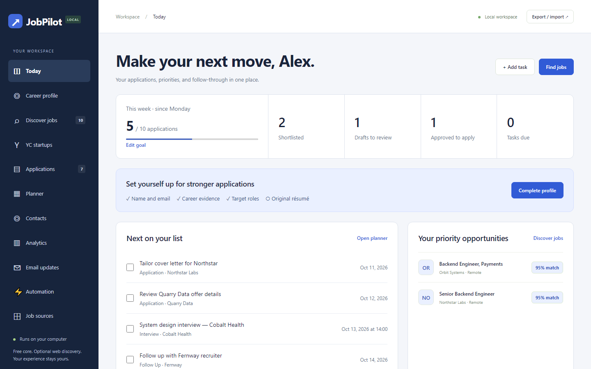
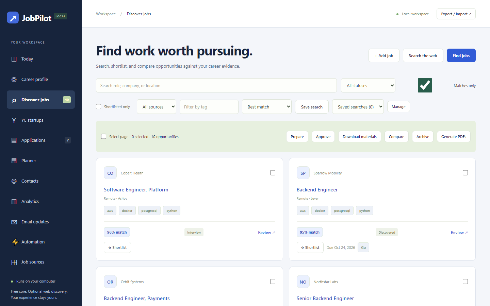
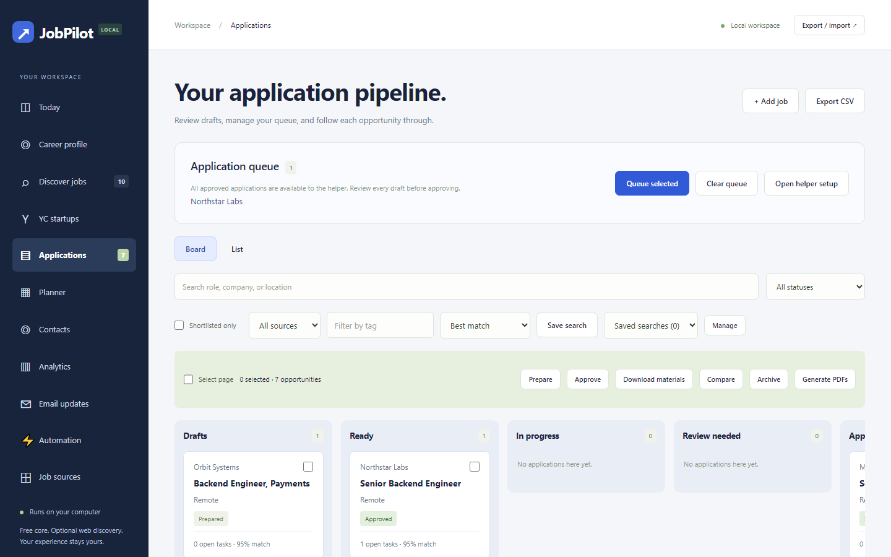
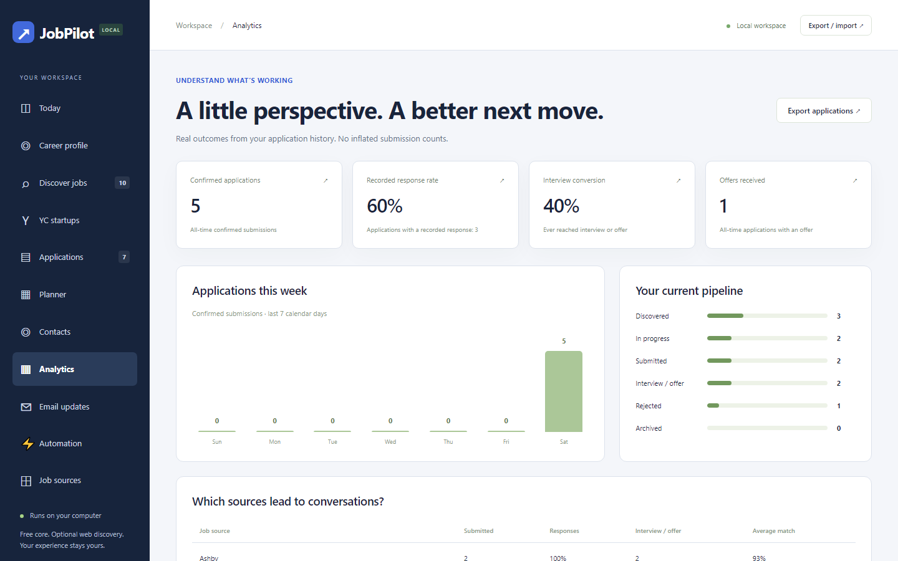

# JobPilot

**A free, local-first job-search workspace.** Turn your career profile into matched roles, tailored résumés, reviewed applications, and honest outcome analytics — all on your own machine.




## Why JobPilot

- **Private by design.** Standard-library Python, SQLite, and plain JavaScript. No account, cloud database, paid API, LLM, or tracking. Binds to `127.0.0.1` only.
- **Evidence over invention.** Résumés, cover letters, and outreach drafts are built from your own saved skills, bullets, and projects. Nothing is fabricated.
- **Human in the loop.** Every application is prepared → reviewed → explicitly approved. Profile or posting edits invalidate stale approvals. Nothing sends messages for you.
- **Honest numbers.** Analytics count only confirmed submissions. Opening or filling a form is never treated as applying.

## How it works

```text
Career profile (or résumé import) → Suggested roles
  → Discovery: Greenhouse · Lever · Ashby · YC · imports
  → Transparent match score → Tailored LaTeX résumé + cover letter
  → Your approval → Browser-helper autofill → Outcome tracking (manual or Gmail)
```

| Discover & score jobs | Application pipeline | Outcome analytics |
| --- | --- | --- |
|  |  |  |

## Quick start

Requires Python 3.10+. No install step.

```sh
python -m jobpilot            # open http://127.0.0.1:8765
python -m jobpilot --port 8766 --data ./private-data
python tests/serve_ui.py      # disposable demo with fictional jobs
```

Optional: [Tectonic](https://tectonic-typesetting.github.io/) for local PDF résumés, Poppler `pdftotext` for PDF résumé import.

## Features

| Area | What you get |
| --- | --- |
| **Profile** | Local résumé import (PDF/DOCX/TXT/MD) with field-by-field review before merge |
| **Discovery** | Public Greenhouse, Lever, Ashby, and YC engineering listings; JSON, Firecrawl, and JobSpy imports |
| **Matching** | 0–100 score from title overlap, skill evidence, location, and posting age — inspectable in [`jobpilot/matching.py`](jobpilot/matching.py) |
| **Tailoring** | Role-focused résumé profiles, per-posting ranking, [Jake's Resume](https://www.overleaf.com/latex/templates/jakes-resume/syzfjbzwjncs) LaTeX output, revision history |
| **Pipeline** | Board/list views, batch prepare/approve, shortlists, tags, deadlines, side-by-side compare |
| **People** | Public-search candidates for peers and recruiters, contacts, editable evidence-based outreach drafts |
| **Tracking** | Planner, `.ics` export, interview prep, optional read-only Gmail sync with review-before-apply |
| **Automation** | Chromium helper ([`extension/`](extension)) autofills standard ATS fields; experimental Lever submit is opt-in and approval-gated |
| **Data** | JSON/CSV export, full SQLite backup, workspace transfer |

## Limits worth knowing

- Match score is not a hiring probability or an employer's ATS score.
- The browser helper has not been validated against live submissions. Start in autofill-only mode; CAPTCHA, logins, and custom widgets need you.
- Contact search returns *candidates* from public results, not verified employees.
- No discovery tool finds every job. Add your own boards under **Job sources**.

## Tests

```sh
python -m unittest discover -s tests -v
node --test tests/*.test.js            # Node 18+, helper only
```

## Docs

- [User guide](docs/GUIDE.md) — full walkthrough, scoring rules, Gmail setup, helper setup, privacy, backups
- [Research](docs/RESEARCH.md) — design rationale and coverage comparison
- [Verification](docs/VERIFICATION.md) — what is fixture-tested vs. live-checked

## License

MIT. The adapted Jake's Resume template (Jake Gutierrez, based on sb2nov/resume) ships with its MIT license in [`jobpilot/templates/LICENSE-jake.txt`](jobpilot/templates/LICENSE-jake.txt).
